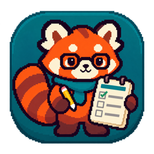

<div align="center">



# PlanLess

**계획은 가볍게, 실천은 바로.**

<p>
  <a href="#start">시작하기</a> &nbsp; / &nbsp;
  <a href="#companions">레서 만나기</a> &nbsp; / &nbsp;
  <a href="#explore">기능 둘러보기</a> &nbsp; / &nbsp;
  <a href="#build">직접 빌드하기</a>
</p>

<a href="#explore">
  <picture>
    <source media="(max-width: 600px) and (prefers-color-scheme: dark)" srcset="docs/readme/hero-mobile-dark.svg">
    <source media="(max-width: 600px)" srcset="docs/readme/hero-mobile-light.svg">
    <source media="(prefers-color-scheme: dark)" srcset="docs/readme/hero-dark.svg">
    
  </picture>
</a>

<p>
<code>macOS 14+</code> &nbsp; <code>Apple Silicon + Intel</code><br>
<code>기기 내 저장</code> &nbsp; <code>소스 v1.1.2</code>
</p>

<sub>위 이미지는 예시 할 일로 구성한 소개 일러스트입니다. 캐릭터는 실제 앱의 승인된 프레임을 사용합니다.</sub>

</div>

<br>

## 계획을 더 만드는 대신, 하나를 시작하기

**Plan + Less.** 해야 할 일을 날짜에 놓고, 지금 할 것 하나를 고르고, 끝냈다면 체크하세요.<br>
복잡한 설정 없이 빈 계획으로 시작하는 작은 macOS 플래너입니다.

<table width="100%">
<tr>
<td width="33%" valign="top">

**01 / 집중**

하루는 가볍게.<br>
한 주는 한눈에.

</td>
<td width="33%" valign="top">

**02 / 실천**

하나씩 시작.<br>
끝내면 체크.

</td>
<td width="33%" valign="top">

**03 / 응원**

레서와 함께.<br>
시작부터 끝까지.

</td>
</tr>
</table>

<a name="companions"></a>

## 혼자 하는 일에도, 작은 응원

앱과 작은 창, 바탕화면 모드, 상단바에서 함께하는 두 레서.<br>
진행 중인 목표가 있으면 계속 응원하고, 쉬는 동안에는 포인터 쪽으로 시선을 옮깁니다.

<table width="100%">
<tr>
<td width="50%" align="center">


**계획단장 레서**

연필 하나, 계획표 하나.<br>
차근차근 시작하는 날의 단짝.

</td>
<td width="50%" align="center">


**열정 레서**

조금 더 힘내고 싶은 순간.<br>
작은 한 걸음에도 힘껏 응원해요.

</td>
</tr>
</table>

<details>
<summary><b>끝냈어요! — 레서의 완료 축하 펼쳐 보기</b></summary>

<br>
<div align="center">

&nbsp;&nbsp;&nbsp;&nbsp;

</div>

새 목표가 완료되면 **1.5초짜리 축하를 정확히 5회**, 총 7.5초 재생합니다. 다른 목표를 진행 중이면 다시 응원으로, 없으면 대기로 돌아갑니다.

<sub>위 GIF는 동작을 살펴보는 반복 미리보기입니다. 앱에서의 5회 재생 횟수를 나타내는 영상은 아닙니다.</sub>

</details>

<details>
<summary><b>잠깐 쉬는 중 — 방향별 전신 포즈 살펴보기</b></summary>

<br>
<div align="center">

</div>

얼굴만 따로 회전하지 않고 목·스카프·어깨가 이어진 전신 포즈를 사용합니다. 이 GIF는 방향별 포즈를 자동으로 보여주는 비교 자료입니다. 실제 포인터 반응은 앱·작은 창·상단바에서 동작합니다.

</details>

<a name="explore"></a>

## 나에게 필요한 만큼만, 펼쳐 보세요

<details open>
<summary><b>하루에 집중하고, 한 주를 넓게 보기</b></summary>

날짜를 눌러 그날의 목표에 집중하거나 **한 주 펼치기**로 월요일부터 일요일까지 살펴보세요. 과목 이름에 따라 앱과 위젯에 같은 색상을 표시합니다.

과목·목표·세부 내용은 직접 추가하고 수정할 수 있습니다. 긴 지침은 접어 두었다가 필요할 때 펼치세요.

</details>

<details>
<summary><b>미뤄진 진행 중 목표는 오늘로 이어가기</b></summary>

날짜가 지난 **진행 중(◐)** 목표는 오늘로 자동 이동합니다. 미시작·완료·삭제한 항목과 미래 계획은 옮기지 않습니다. 앱 재실행·활성화·날짜 변경 때 같은 기준을 적용합니다.

목표의 ID와 수정 내용, 상태를 유지하므로 이어서 진행하면 됩니다.

</details>

<details>
<summary><b>앱·상단바·바탕화면, 편한 자리에서 체크하기</b></summary>

앱을 작게 줄이거나 다른 창 위에 고정하고, 바탕화면 모드로 둘 수 있습니다. 상단바 레서에서도 캐릭터와 목표를 고르고 진행·완료를 누를 수 있어요.

**정식 macOS WidgetKit 위젯**은 하루 목표 소·중·대와 주간 목표 대를 제공합니다. 체크를 누르면 앱을 열어 목표 상태를 바꿉니다.

시스템 위젯은 대표 정지 이미지를 표시합니다. 연속 애니메이션·포인터 추적은 앱과 상단바에서 동작하며, 시스템 위젯의 갱신 시점은 macOS가 결정합니다.

</details>

<details>
<summary><b>AI가 정리한 계획은 붙여넣어 한 번에 등록하기</b></summary>

1. 앱에서 **AI 계획 → 입력 양식 → 양식 복사**를 누릅니다.
2. GPT·Claude 등에 계획을 요청하면서 양식을 함께 전달합니다.
3. 받은 JSON을 붙여넣고 **미리보기 → 등록**을 누릅니다.

날짜·필수 항목·길이를 확인하고, 날짜·과목·제목·세부 내용이 같은 항목은 건너뜁니다. 기존 계획은 유지됩니다.

앱이 직접 AI를 호출하거나 계획을 외부로 보내지는 않습니다.

</details>

<details>
<summary><b>내 기록은 내 Mac에 — 계정 없이 쓰기</b></summary>

로그인·광고·분석 수집·클라우드 동기화 없이 기기 안에 저장합니다. 처음 실행하면 빈 계획으로 시작합니다.

이름 변경 후에도 기존 기록이 이어지도록 저장 경로와 앱·위젯의 영구 식별자를 유지합니다. 앱을 업데이트하거나 삭제해도 사용자 기록을 자동으로 지우지 않습니다.

[저장 위치와 백업 안내](docs/installation.md#data)

</details>

<a name="start"></a>

## 시작하기

| 지금 원하는 것 | 바로가기 |
| :-- | :-- |
| **새 이름과 레서판다 아이콘이 있는 최신 소스** | [PlanLess 1.1.2 직접 빌드](#build) |
| 기존 공개 설치판을 내려받기 | [v1.0.3 릴리스 — 이전 이름 Study Glass](https://github.com/hyunmin-apps/PlanLess/releases/tag/v1.0.3) |
| 설치 과정·첫 실행·기록 백업 확인하기 | [설치 안내](docs/installation.md) |

> [!IMPORTANT]
> **소스는 PlanLess 1.1.2, 공개 설치판은 Study Glass 1.0.3입니다.** 새 이름과 레서 아이콘이 들어간 설치 파일은 아직 공개 릴리스하지 않았습니다. 최신 로컬 설치판을 이전 공개 설치기로 덮어쓰지 마세요.

<details>
<summary><b>기존 공개 설치판(v1.0.3) 설치 방법</b></summary>

[StudyGlass-1.0.3-Install.command 받기](https://github.com/hyunmin-apps/PlanLess/releases/download/v1.0.3/StudyGlass-1.0.3-Install.command)

다운로드 폴더에 둔 뒤 아래 **한 줄 전체**를 실행합니다.

```bash
/bin/bash "$HOME/Downloads/StudyGlass-1.0.3-Install.command"
```

안내를 확인하고 `y`를 입력하면 공식 ZIP의 SHA-256과 서명 구조를 검사한 후 `~/Applications`에 설치합니다. 해당 앱에만 다운로드 격리 해제를 적용하며 관리자 암호는 필요하지 않습니다.

**Apple 공증 전 시험판입니다.** 실행 중인 앱은 종료하므로 편집 내용을 먼저 저장하세요. 이전 앱은 압축 백업하고 기록은 유지합니다. [자세한 설치 안내](docs/installation.md)

</details>

<a name="build"></a>

## 직접 빌드하기

macOS 14 이상, Xcode Command Line Tools 또는 Xcode, Python 3이 필요합니다.

```sh
git clone https://github.com/hyunmin-apps/PlanLess.git
cd PlanLess
./build.sh
open 'build/universal/PlanLess.app'
```

Apple Silicon·Intel을 함께 담은 Universal 앱과 위젯을 만듭니다. 사용 중인 설치 앱을 자동 교체하지 않습니다.

<details>
<summary><b>지원 범위와 실제 검증 결과</b></summary>

| 항목 | 범위 |
| :-- | :-- |
| Apple Silicon | 개발 Mac에서 앱·상단바·WidgetKit 실행 확인 |
| Intel | x86_64 바이너리 포함. 실제 Intel Mac 위젯 배치는 미확인 |
| 최소 OS | macOS 14.0. 최소 버전 실기기 검증은 미실시 |
| 서명 | 로컬 ad-hoc. Developer ID·Apple 공증 없음 |
| 시스템 위젯 | 대표 정지 이미지·앱 연결 체크. 갱신 시점은 macOS 정책에 따름 |

[빌드 기록](https://github.com/hyunmin-apps/PlanLess/actions/workflows/build.yml) · [검증 범위](docs/verification.md) · [이름·아이콘 변경 검증](docs/rename-verification.json)

</details>

[개발·테스트·배포 가이드](docs/development.md) &nbsp; · &nbsp; [변경 기록](CHANGELOG.md) &nbsp; · &nbsp; [로컬 작업 인계](HANDOFF-next-session.md)

<br>

---

<div align="center">


**계획을 잘 짜는 날보다, 하나를 시작하는 날이 많아지도록.**

<sub>Made for small starts. Built for your Mac.</sub>

<br><br>

[버그 제보](https://github.com/hyunmin-apps/PlanLess/issues/new?template=bug_report.md) &nbsp; · &nbsp; [MIT License](LICENSE) &nbsp; · &nbsp; [아이콘 제작 기록](design/planless-icon/README.md)

</div>
